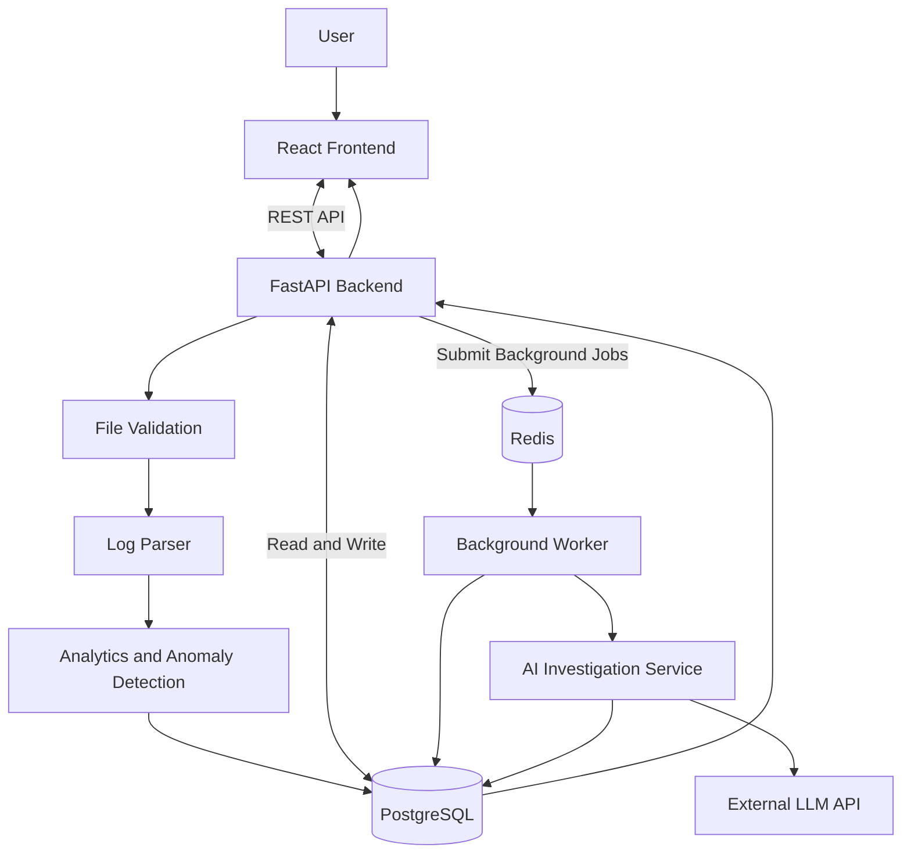

# OpsLens — System Architecture

## 1. Overview

OpsLens is a web-based log analysis and incident investigation platform. It allows users to upload server logs, explore system activity, identify unusual patterns, and investigate potential incidents using AI-assisted analysis.

The application follows a modular client-server architecture. The frontend communicates with a Python backend through a REST API. The backend handles log processing, data storage, analytics, and AI investigation.

## 2. Technology Stack

| Component | Technology | Responsibility |
|---|---|---|
| Frontend | React, TypeScript | User interface and data visualization |
| Backend | Python, FastAPI | API endpoints and application logic |
| Validation | Pydantic | Request and response validation |
| Database | PostgreSQL | Persistent application data |
| ORM | SQLAlchemy | Database interaction |
| Migrations | Alembic | Database schema versioning |
| Background Processing | Redis | Task coordination and job queuing |
| Worker | Python | Asynchronous processing tasks |
| AI Integration | External LLM API | Evidence-based incident investigation |
| Infrastructure | Docker | Application containerization |
| CI/CD | GitHub Actions | Automated testing and build workflows |

## 3. High-Level Architecture

The following diagram illustrates how the main components interact.

## 4. Core Components

### 4.1 Frontend

The frontend is built using React and TypeScript.

Its responsibilities include:

- Providing the log upload interface.
- Displaying analysis dashboards and summary metrics.
- Allowing users to search and filter log events.
- Visualizing event frequency, severity distributions, and anomalies.
- Presenting AI-generated investigation results.
- Allowing users to export incident reports.

The frontend communicates with the backend through HTTP requests to the REST API.

### 4.2 Backend API

The backend is built using Python and FastAPI.

It acts as the central application layer, coordinating requests between the frontend, processing engine, database, and AI service.

Its responsibilities include:

- Receiving and validating uploaded files.
- Coordinating log parsing and analysis.
- Exposing endpoints for retrieving and filtering log events.
- Managing analysis and incident records.
- Initiating background tasks.
- Coordinating AI investigations.
- Returning structured responses to the frontend.

Pydantic models will be used to validate incoming requests and define consistent API response structures.

### 4.3 Log Processing Engine

The processing engine handles the transformation of uploaded files into structured log events.

The initial implementation will support:

- Plain-text log files (`.log` and `.txt`).
- JSON Lines files (`.jsonl`).

Processing includes:

1. Reading and validating the uploaded file.
2. Identifying supported log formats.
3. Extracting timestamps, severity levels, messages, and available metadata.
4. Normalizing entries into a consistent data structure.
5. Handling malformed or incomplete entries.
6. Persisting successfully parsed events.

The parser will be designed as a modular component so additional log formats can be supported later.

### 4.4 Analytics and Anomaly Detection

The analytics component examines normalized log events to identify unusual activity.

Initial analysis techniques will include:

- Event frequency analysis.
- Error and warning counts.
- Rolling averages.
- Standard deviation and Z-score calculations.
- Unusual increases in error frequency.
- Service-level activity comparisons.

Detected anomalies will be associated with relevant log events so users can investigate the underlying activity.

### 4.5 Database

PostgreSQL will store the application's persistent data.

Initial entities will include:

- **Upload:** Metadata about uploaded files and their processing status.
- **LogEvent:** Individual normalized log entries.
- **Incident:** Records representing potential incidents or investigations.
- **Analysis:** Results generated by statistical and AI analysis.

SQLAlchemy will manage database interactions, while Alembic will track changes to the database schema through migrations.

### 4.6 Background Processing

Redis will coordinate longer-running tasks through a background worker.

This prevents expensive operations, such as large-file processing and AI investigations, from unnecessarily blocking API requests.

The initial API may process smaller uploads synchronously. Background processing will be introduced for operations that benefit from asynchronous execution.

### 4.7 AI Investigation Service

The AI investigation service will provide explanations and troubleshooting recommendations based on relevant log evidence.

The workflow will be:

1. Identify an anomaly or investigation request.
2. Retrieve relevant log events from PostgreSQL.
3. Construct a limited context containing the selected evidence.
4. Submit the context to an external language model API.
5. Validate and structure the returned analysis.
6. Store the investigation results and associated evidence references.
7. Return the results to the frontend.

AI-generated responses must distinguish between:

- **Observed facts:** Information directly supported by the logs.
- **Possible explanations:** Hypotheses that may explain the observed activity.
- **Recommendations:** Suggested next steps for investigation.

Every factual claim should reference relevant log event identifiers where possible.

Uploaded log content must be treated as untrusted input. Instructions embedded in log messages must never be treated as instructions for the AI system.

## 5. Data Flow

The primary application workflow is:

1. A user uploads a log file through the frontend.
2. The backend validates the file and its size.
3. The processing engine parses and normalizes the entries.
4. Normalized events and upload metadata are stored in PostgreSQL.
5. Analytics identify unusual activity and generate summary metrics.
6. The frontend retrieves and displays the results.
7. A user selects an anomaly or requests an investigation.
8. The backend retrieves relevant evidence and initiates AI analysis.
9. The AI service returns structured findings and evidence references.
10. The user reviews the investigation and exports an incident report.

## 6. Deployment Architecture

OpsLens is intended to be publicly accessible through a hosted web application.

The planned deployment separates the frontend, backend, and managed data services.

| Component | Planned Hosting |
|---|---|
| Frontend | Vercel or equivalent |
| Backend API | Render or equivalent |
| PostgreSQL | Managed PostgreSQL provider |
| Redis | Managed Redis provider |
| AI | External API provider |

Final hosting choices will depend on deployment requirements, pricing, and available service limits.

Docker will be used to make the backend and worker environments reproducible.

## 7. Security and Reliability

Security and reliability considerations include:

- Restricting accepted file types and upload sizes.
- Preventing unsafe file paths and file execution.
- Keeping API keys and database credentials out of source control.
- Validating API inputs and outputs.
- Applying rate limits to resource-intensive endpoints.
- Handling malformed log entries without crashing the parser.
- Managing database errors and failed background jobs.
- Limiting the amount of log data sent to external AI services.
- Treating uploaded log content as untrusted data.
- Providing appropriate data retention and deletion controls.

## 8. Future Improvements

Potential future extensions include:

- Live log ingestion.
- A lightweight Go-based log ingestion agent.
- Additional log formats and data sources.
- More advanced anomaly detection.
- User authentication and persistent workspaces.
- Saved investigations and historical comparisons.
- Expanded AI-assisted troubleshooting capabilities.

These features are outside the initial MVP unless development time allows.
